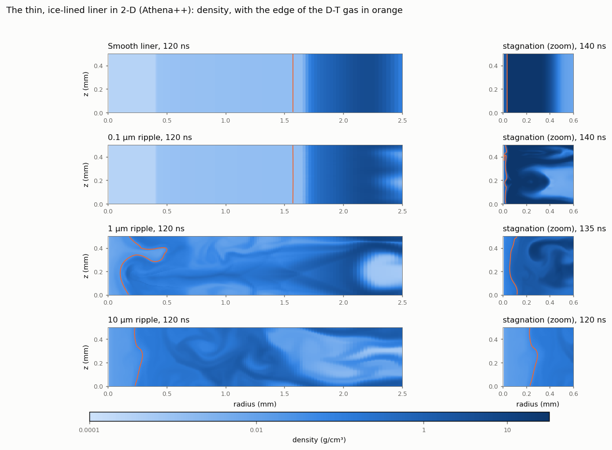
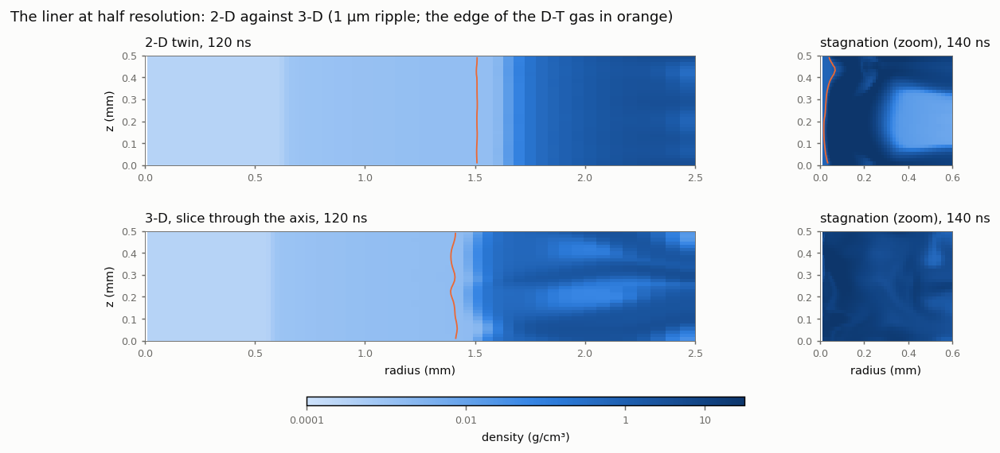
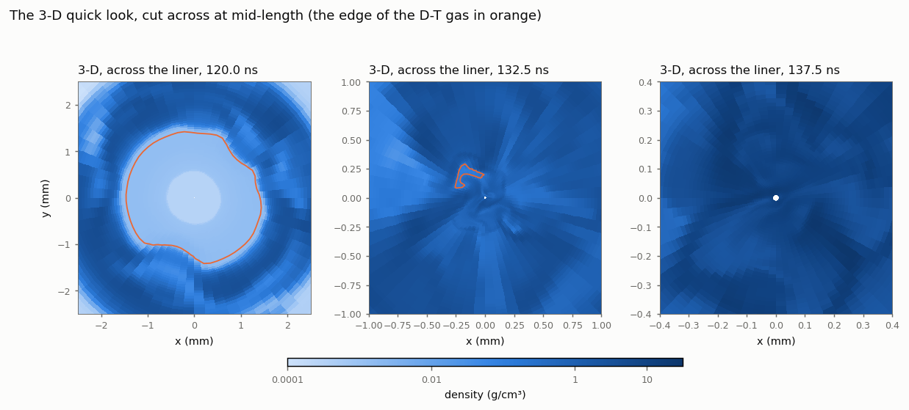

# The thin, ice-lined liner in 2-D and 3-D (Athena++)

Produced by `tools/athena_liner.py` from Athena++ runs of `tools/athena/liner.cpp`. The design and the 0-D model's prediction (~177× convergence) are in [docs/liner_experiment.md](../../liner_experiment.md). Convergence is the gas's starting rms radius over its smallest.

| Case | Liner ripple (rms) | Fuel convergence at stagnation | When | Gas temperature then | Liner's inner surface spread (r-z slice nearest stagnation) | Beryllium in the hot gas, then |
|---|---|---|---|---|---|---|
| flat | 0 µm | 69× (36 µm rms) | 141.2 ns | 5.5 keV | 0 µm at 140 ns | 1% of the gas mass |
| ripple 0.1 um | 0.1 µm | 25× (101 µm rms) | 137.7 ns | 3.8 keV | 39 µm at 140 ns | 17% of the gas mass |
| ripple 1 um | 1 µm | 9× (269 µm rms) | 135.6 ns | 2.3 keV | 66 µm at 135 ns | 19% of the gas mass |
| ripple 10 um | 10 µm | 5× (549 µm rms) | 118.9 ns | 3.2 keV | 538 µm at 120 ns | 4% of the gas mass |
| 3-D quick look | 1 µm | 7× (341 µm rms) | 138.6 ns | 0.12 keV | 0 µm at 140 ns | no mostly-gas cell left in the slice |
| 2-D twin | 1 µm | 25× (102 µm rms) | 141.5 ns | 1.4 keV | 82 µm at 140 ns | 11% of the gas mass |
| physics flat | 0 µm | 84× (30 µm rms) | 131.1 ns | 0.72 keV | 0 µm at 130 ns | 0% of the gas mass |

## With the physics a yield needs

Burn, alpha heating, radiation, resistivity, conduction, two temperatures, the Nernst effect, the bank circuit and a real equation of state (tools/athena/liner.cpp, physics build); each "no X" case switches one off. Energies are for the whole 1 cm liner. Electric gain is counted as the 0-D simulator counts it (lithium blanket, 40% heat to electricity, the bank charged at 15%): the 0-D model's figure for this design is 22.

| Case | Yield | Electric gain | Fuel burnt | Peak fusion power | Bang time | Burn width | Convergence | Ended |
|---|---|---|---|---|---|---|---|---|
| physics flat | 3.65e+04 J | 0.000281 | 0.00% | 1.3e+13 W | 128.4 ns | 2.57 ns | 84× | 180 ns |

| Case | Burn-weighted T_i / T_e | B_z, B R | Burn radius | Burn in Be-mixed cells | Peak current | Into the load | Radiated | Alpha energy deposited / made |
|---|---|---|---|---|---|---|---|---|
| physics flat | 4.30 / 4.06 keV | 1.16e+04 T, 0.37 T m | 21 µm | 0% | 33.1 MA | 5.61e+05 J | 8.21e+04 J | 100% |

## 3-D quick look: departures from axisymmetry

| Time | Liner inner surface (mean) | Its rms ripple: axisymmetric | non-axisymmetric | Strongest non-axisymmetric mode (m, n) | Fuel rms radius | Fuel column off axis (max) |
|---|---|---|---|---|---|---|
| 0.0 ns | 4170 µm | 0.0 µm | 0.0 µm | (0, 0) | 2502 µm | 0.0 µm |
| 20.0 ns | 4170 µm | 0.0 µm | 0.0 µm | (0, 0) | 2502 µm | 0.0 µm |
| 40.0 ns | 4170 µm | 0.0 µm | 0.0 µm | (0, 0) | 2502 µm | 0.0 µm |
| 60.0 ns | 4170 µm | 0.0 µm | 0.0 µm | (0, 0) | 2502 µm | 0.0 µm |
| 80.0 ns | 3843 µm | 0.0 µm | 0.0 µm | (0, 0) | 2502 µm | 0.0 µm |
| 100.0 ns | 3131 µm | 8.6 µm | 49.2 µm | (-7, 5) | 2402 µm | 73.9 µm |
| 120.0 ns | 1542 µm | 16.9 µm | 153.1 µm | (2, 0) | 1433 µm | 223.8 µm |
| 135.0 ns | beryllium on the axis (100% of the length and circle) | – | – | – | 385 µm | 102.5 µm |
| 137.5 ns | beryllium on the axis (100% of the length and circle) | – | – | – | 344 µm | 177.4 µm |
| 140.0 ns | beryllium on the axis (100% of the length and circle) | – | – | – | 346 µm | 158.8 µm |
| 142.5 ns | beryllium on the axis (100% of the length and circle) | – | – | – | 384 µm | 123.3 µm |
| 160.0 ns | beryllium on the axis (100% of the length and circle) | – | – | – | 1233 µm | 538.3 µm |
| 180.0 ns | beryllium on the axis (100% of the length and circle) | – | – | – | 2182 µm | 653.7 µm |

